# Fitness and Habit Tracker

A Flutter mobile application designed to help users build healthy routines by tracking workouts, daily habits, step goals, and progress over time.

The app brings the user's main fitness activities together in one place: log a workout, review activity history, maintain daily habits, and monitor progress through weekly and monthly summaries.

> **Health disclaimer:** This application is intended for general fitness and habit tracking only. It does not provide medical advice, diagnosis, or treatment. Users should choose activities appropriate for their abilities and consult a qualified professional when they need health guidance.

## Team Members

- Rafia Naeem
- Kabeer Khan
- Muzaffar

## Main Features

- **Account access:** Sign-in and account-related screens.
- **Home dashboard:** At-a-glance view of daily steps, habits, workout activity, and weekly summary.
- **Workout tracking:** Start a workout or record a past workout.
- **Workout history:** Review previously recorded workouts.
- **Exercise catalogue:** Browse and search exercises.
- **Exercise details:** View information about a selected exercise.
- **Habit tracking:** Add habits and mark daily habits as complete.
- **Progress tracking:** Review workout and habit progress over weekly and monthly periods.
- **Profile and settings:** Manage profile details, goals, reminders, theme, and preferences.
- **Weekly summary:** Review a summary of activity and consistency.

## Technology and Planned Integrations

| Technology / Package | Purpose |
|---|---|
| Flutter | Cross-platform mobile application UI |
| Dart | Application programming language |
| wger REST API | Exercise catalogue and exercise information |
| Device activity / step sensor | Step-count tracking, subject to device support and permission |
| Notifications | Daily goal and habit reminders |
| Local database (planned) | Store workout logs, habits, and user preferences |
| Firebase Authentication (planned) | Account authentication and sign-in |

> Integrations marked as **planned** are feature-map targets and should not be considered complete until they are connected and tested in the app.

## Screens

The following section places the current app screenshot beside the corresponding hand-drawn sketch reference. The sketch photos are the original design references; some photos contain more than one sketched screen.

### 1. Home Dashboard

| App screenshot | Original sketch |
|---|---|
| 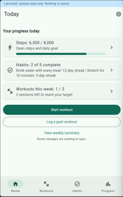 | 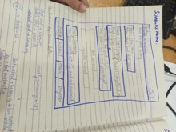 |

The dashboard gives users a quick overview of their daily steps, habit completion, workout activity, and weekly summary.

### 2. Workouts and History

| App screenshot | Original sketch |
|---|---|
| 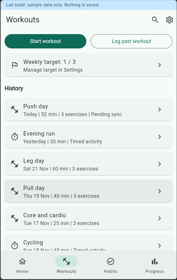 | 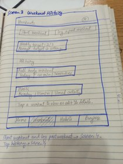 |

Users can start a workout, log a past workout, and review previous activity.

### 3. Workout Log

| App screenshot | Original sketch |
|---|---|
| 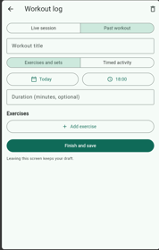 | 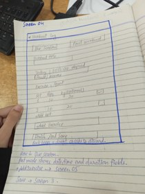 |

The workout log screen is used to enter workout information, exercises, duration, and related activity details.

### 4. Habits

| App screenshot | Original sketch |
|---|---|
| 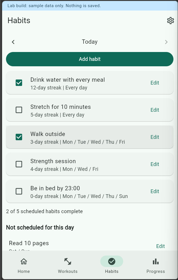 | 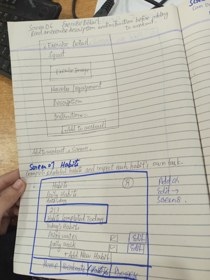 |

Users can view their habits, add a habit, and mark habits as completed for the day.

### 5. Progress

| App screenshot | Original sketch |
|---|---|
| 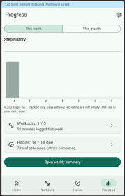 | 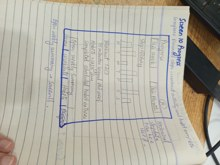 |

The progress screen presents activity information and supports reviewing progress over different time periods.

### 6. Profile and Settings

| App screenshot | Original sketch |
|---|---|
| 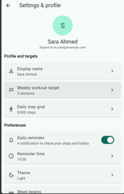 | 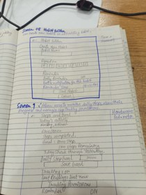 |

Users can manage profile information, workout and step goals, reminders, theme, and preferences.

### 7. Save Confirmation State

| App screenshot | Original sketch |
|---|---|
| 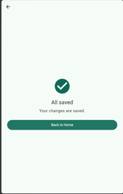 | No separate hand-drawn sketch for this confirmation state was included in the uploaded set. |

This is a confirmation state shown after information has been saved.

### 8. Empty Workouts State

| App screenshot | Original sketch |
|---|---|
| 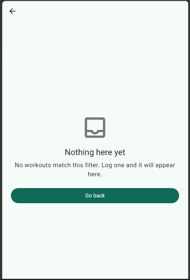 | No separate hand-drawn sketch for this empty state was included in the uploaded set. |

This state guides the user when no workout records are available yet.

### 9. Workout Error State

| App screenshot | Original sketch |
|---|---|
| 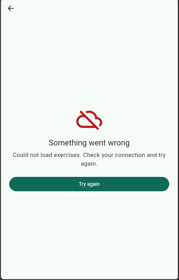 | No separate hand-drawn sketch for this error state was included in the uploaded set. |

This state communicates that workout information could not be loaded and provides a retry action.

### 10. Theme Selection

| App screenshot | Original sketch |
|---|---|
| 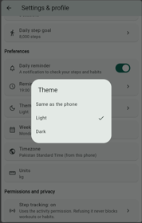 | 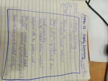 |

The theme selection dialog lets users choose the application's appearance. The weekly-summary sketch is included as the remaining original design reference and is not an exact wireframe for this dialog.

### Additional Original Sketches

These hand-drawn screens were also present in the uploaded sketch photos, but a matching standalone app screenshot was not included in the screenshot set. Add the corresponding screenshot beside each sketch when that screen is implemented.

| Hand-drawn sketch | Screen |
|---|---|
| 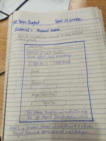 | Account Access |
| 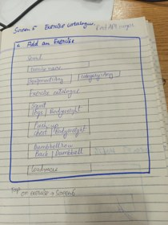 | Exercise Catalogue |
| 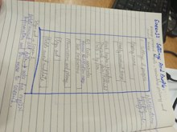 | Search / Add Exercise |
|  | Weekly Summary |
|  | Contains the Exercise Details and Habits wireframes |

## Feature Map

The feature map identifies which future integration belongs to each screen and the planned implementation stage.

| Screen | Feature that plugs in | When |
|---|---|---|
| Account Access | Firebase Authentication, Google Sign-In, account validation, password-reset flow | Next week |
| Home Dashboard | Step-count sensor, daily goal progress, dashboard data, weekly summary data | Hardware session / database integration |
| Workouts and History | Local database for workout records; retrieve and display saved workout history | Already learned — wire into the screen |
| Workout Log | Save workout date, duration, exercises, sets, and activity details to the local database | Database integration session |
| Exercise Catalogue | wger REST API for exercise search, catalogue data, and filtering | REST API session |
| Exercise Details | wger REST API for selected exercise information and instructions | REST API session |
| Habits | Save habit records and completion status; daily reminder notifications | Database and notifications session |
| Progress | Read workout and habit records and display weekly/monthly progress charts | Database and charts integration |
| Profile and Settings | Save profile details, step goal, workout target, reminder settings, and theme preferences | Local storage / database session |
| Weekly Summary | Calculate weekly workout totals, habit completion, step progress, and streak information | Database and charts integration |
| Activity Permission | Request activity-recognition permission and show a graceful explanation/fallback if permission is denied | Hardware session |

### Feature Map Notes

- The wger API is intended for exercise catalogue and exercise-detail information.
- Step tracking depends on device hardware, operating-system support, and user permission.
- If activity permission is denied, the app should remain usable and explain that automatic step tracking is unavailable.
- Notifications are intended for reminders and daily goals; users should be able to control reminder preferences.
- The app should not make medical claims or present tracked values as medical measurements.

## Project Setup

### Prerequisites

- Flutter SDK installed
- Dart SDK (included with Flutter)
- Android Studio or Visual Studio Code
- An Android emulator or a physical Android device

### Run the Application

1. Clone or download this repository.
2. Open the project folder in Visual Studio Code or Android Studio.
3. Open a terminal in the project directory.
4. Fetch the Flutter dependencies:

   ```bash
   flutter pub get
   ```

5. Check that a device or emulator is available:

   ```bash
   flutter devices
   ```

6. Run the application:

   ```bash
   flutter run
   ```

## Suggested Project Structure

The exact folder structure may vary as the project develops. A typical Flutter structure is:

```text
fitness_habit_tracker/
├── android/
├── ios/
├── lib/
│   ├── main.dart
│   ├── screens/
│   ├── widgets/
│   ├── models/
│   └── services/
├── assets/
├── test/
├── pubspec.yaml
└── README.md
```

## Permissions and Privacy

- Request activity or step-count permission only when the related feature is introduced.
- Explain why the permission is needed before or during the permission request.
- Handle denied permissions gracefully; core workout and habit screens should remain accessible.
- Store only the information required for the app's features.
- Allow users to manage reminder preferences.

## Current Scope

The current project focuses on the app screens, visual design, and navigation between screens. Some integrations in the feature map are planned for later development sessions. Their presence in this README describes the intended implementation, not a claim that every integration is already complete.

## Future Improvements

- Complete authentication and account recovery.
- Connect the exercise catalogue to the wger REST API.
- Persist workout and habit records.
- Integrate device step counting with permission handling.
- Add configurable daily reminders.
- Add progress charts and weekly summaries.
- Test navigation, empty states, error states, and permission-denied behavior.

---

**Project:** Fitness and Habit Tracker  
**Course:** Mobile Application Development (CS 442)  
**Semester:** Fall 2026
