# Lab: From Hand-Drawn Sketches to Working Screens

CS 442 Mobile Application Development, Fall 2026. Capstone: **Fitness and Habit Tracker**.

The screens of the capstone app, rebuilt the way the lab asks: they look right, they are connected by navigation, and every number on them comes from fake, hard-coded data in [`lib/data/sample_data.dart`](lib/data/sample_data.dart). Firebase, the step sensor, notifications and the wger REST API plug into these screens in the coming labs (see the [feature map](#feature-map)).

**Level reached: Gold.** All twelve capstone screens (S01 to S12) plus Welcome and the success, empty and error screens, with all four stretch goals.

> For fitness tracking and motivation only. This app does not provide medical advice.

## Run it

```bash
cd lab_sketch_to_screens
flutter pub get
flutter run -d edge
```

`-d chrome` or an Android phone works too. On Account access, any email and a password of six or more characters opens the app. Nothing is sent anywhere.

Check that every screen opens, fits a phone and is connected:

```bash
flutter analyze
flutter test
```

## What the lab asked for, and where it is

| Lab step | Done in |
|---|---|
| Step 0: structure, theme, routes | `lib/main.dart`, `lib/app/theme.dart`, `lib/app/router.dart` (GoRouter, one `GoRoute` per screen, all in one file), `lib/data/sample_data.dart` |
| Step 1: shared widgets | `AppCard` and `PrimaryButton` from the handout (with a few optional extras), and four widgets of my choice: `SectionTitle`, `ImagePlaceholder`, `InfoRow`, `StatusView` |
| Step 2: template trick, one screen per file | 14 files in `lib/presentation/screens/` (the three result screens share one file), each built from the LIST, FORM, DETAIL or centred-column template (table below) |
| Step 3: connect and check | Every screen is reachable by tapping and has a way back. `flutter test` opens every route at 320 px wide, at 1.3x text size, in the dark theme and in a 1280 px browser window, and fails on any overflow stripe |
| Step 4: README | This file: screenshots, sketch slots and the feature map |
| Stretch: dark theme | `appDarkTheme` in `lib/app/theme.dart`; follows the phone, or pick Light/Dark in Settings > Theme |
| Stretch: bottom NavigationBar | `lib/presentation/widgets/app_shell.dart` with `StatefulShellRoute` for Home, Workouts, Habits, Progress |
| Stretch: Hero animation | The exercise icon flies from the catalogue card (or grid tile) to the picture on Exercise detail |
| Stretch: GridView | Exercise catalogue has a list/grid switch (the icon next to "Exercise catalogue") |

Rules from the handout that the code follows: no image files (icons and coloured boxes only), no fixed pixel widths or heights for layout (`Expanded`, `Padding`, `ListView`, `AspectRatio` instead), and the same items in the same order as the capstone screens.

## Folder structure

```
lib/
  main.dart                       MaterialApp.router, light + dark theme
  app/
    theme.dart                    seed colour, light and dark ThemeData
    router.dart                   every route, one GoRoute per screen
    format.dart                   small text helpers (6,300 / "Yesterday" / 19:00)
  data/
    sample_data.dart              fake data: profile, exercises, workouts, habits, steps
  presentation/
    widgets/
      app_card.dart               AppCard (shared widget 1)
      primary_button.dart         PrimaryButton (shared widget 2) + SecondaryButton
      section_title.dart          SectionTitle (shared widget 3)
      image_placeholder.dart      ImagePlaceholder
      info_row.dart               InfoRow
      status_view.dart            StatusView (big icon, message, button)
      disclaimer_text.dart        the health disclaimer
      step_bar_chart.dart         steps chart made of plain widgets
      app_shell.dart              bottom NavigationBar, Settings button, snack and confirm helpers
    screens/                      one file per screen (table below)
test/
  app_test.dart                   opens every route, checks overflow, taps through the main flows
  screenshots_test.dart           makes the pictures in docs/screenshots/
docs/
  screenshots/                    one picture per screen
  sketches/                       photos of the hand-drawn sketches go here
```

## Screens

Put a photo of each hand-drawn sketch in [`docs/sketches/`](docs/sketches/) with the file name shown in the table (for example `docs/sketches/03_home.jpg`); the Sketch column picks it up.

| # | Screen | Template | Route | File | Sketch | Screen |
|---|---|---|---|---|---|---|
| 01 | Welcome | Centred column | `/` | `welcome_screen.dart` |  | 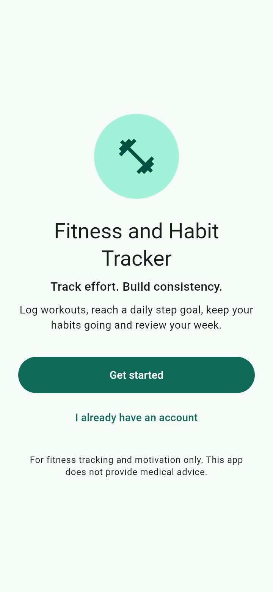 |
| 02 | S01 Account access | FORM | `/login` | `login_screen.dart` |  | 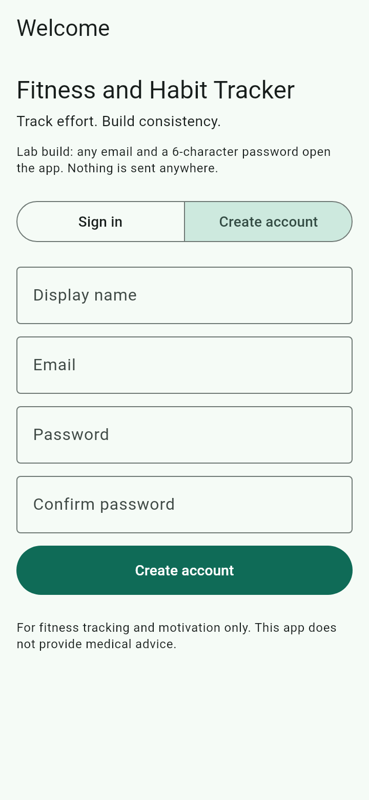 |
| 03 | S02 Home | LIST | `/home` | `home_screen.dart` |  | 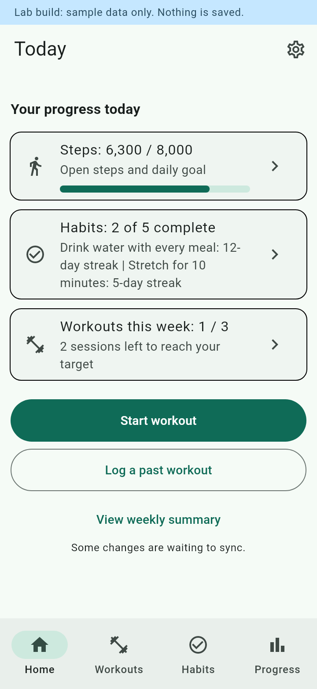 |
| 04 | S03 Workout history | LIST | `/workouts` | `workout_history_screen.dart` |  | 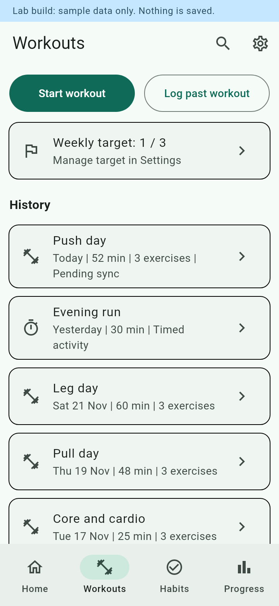 |
| 05 | S04 Workout log | FORM | `/workouts/log` | `workout_log_screen.dart` |  | 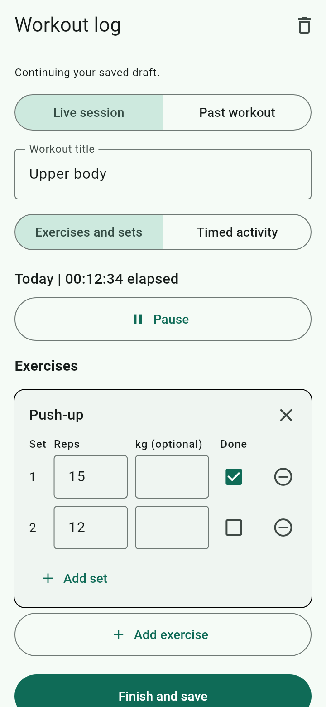 |
| 06 | S05 Exercise catalogue | SEARCH (TextField + LIST) | `/exercises` | `exercise_catalogue_screen.dart` |  | 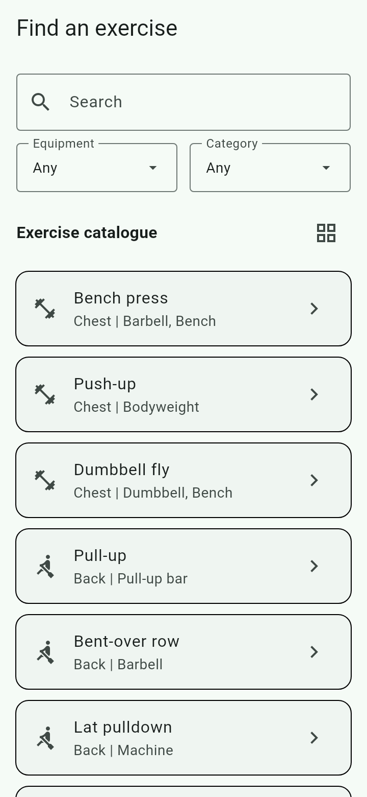 |
| 07 | S06 Exercise detail | DETAIL | `/exercises/:id` | `exercise_detail_screen.dart` |  | 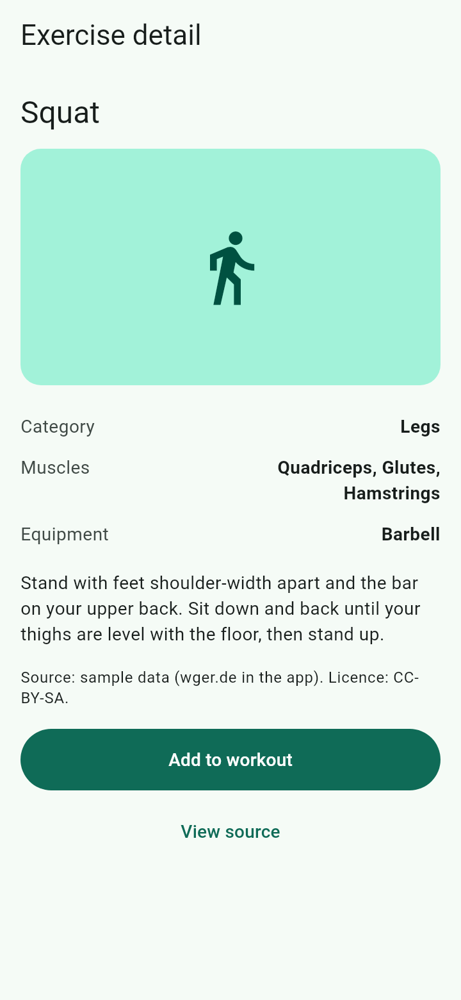 |
| 08 | S07 Habits | LIST | `/habits` | `habits_screen.dart` |  | 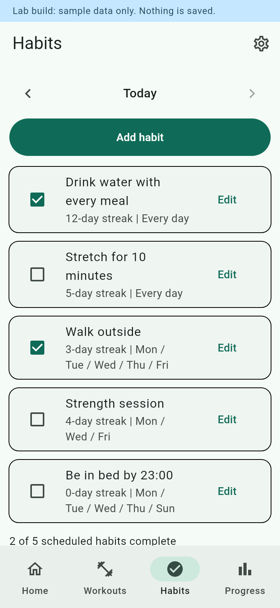 |
| 09 | S08 Habit editor | FORM | `/habits/edit` | `habit_editor_screen.dart` |  | 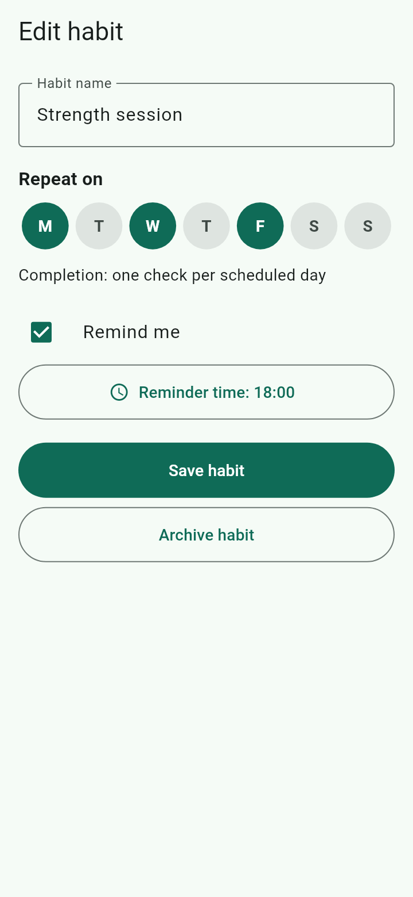 |
| 10 | S09 Steps and daily goal | DETAIL | `/steps` | `steps_screen.dart` |  | 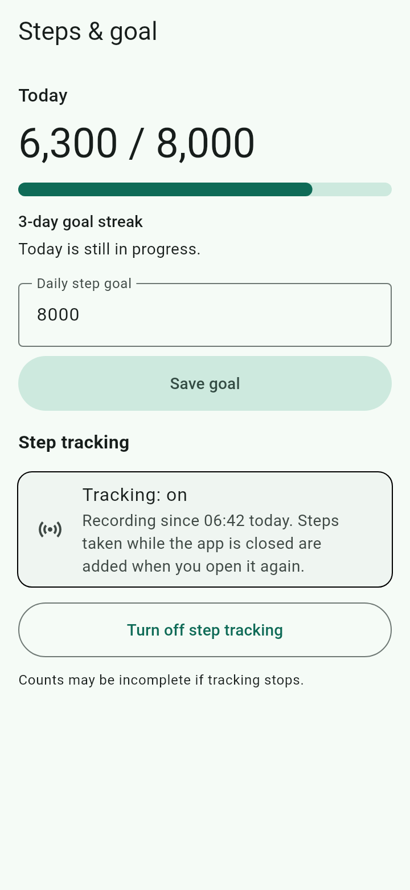 |
| 11 | S10 Progress | LIST | `/progress` | `progress_screen.dart` |  | 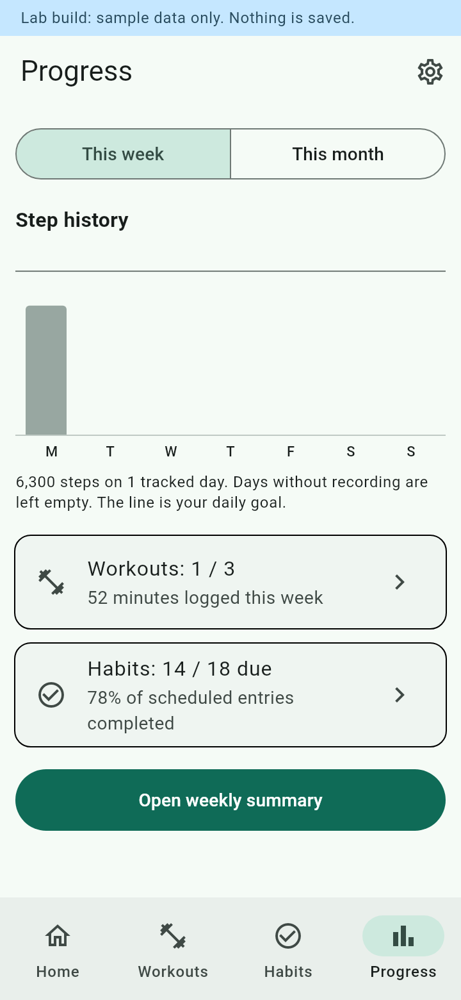 |
| 12 | S11 Weekly summary | DETAIL | `/summary` | `weekly_summary_screen.dart` |  | 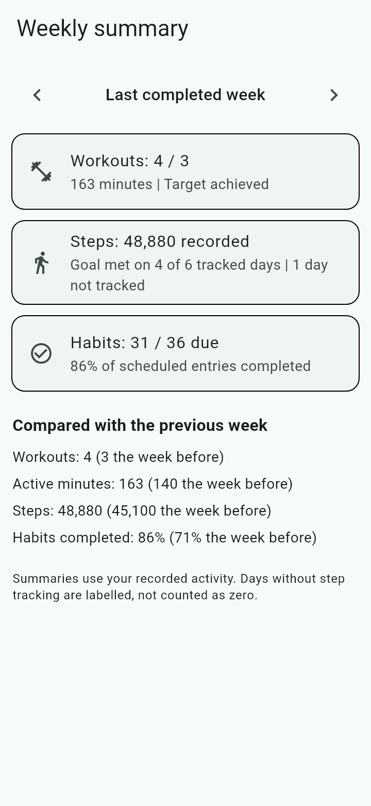 |
| 13 | S12 Settings and profile | LIST of tiles + avatar | `/settings` | `settings_screen.dart` |  | 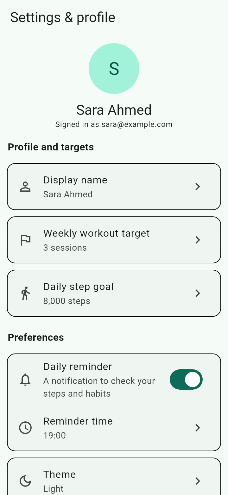 |
| 14 | Success | Centred column | `/result/success` | `result_screen.dart` |  | 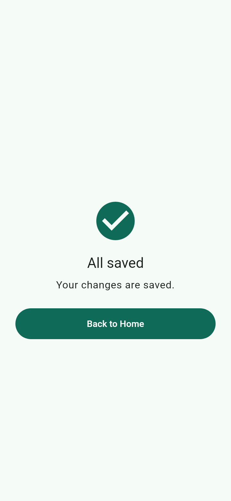 |
| 15 | Empty | Centred column | `/result/empty` | `result_screen.dart` |  | 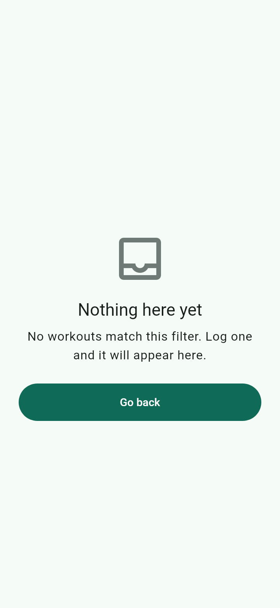 |
| 16 | Error | Centred column | `/result/error` | `result_screen.dart` |  | 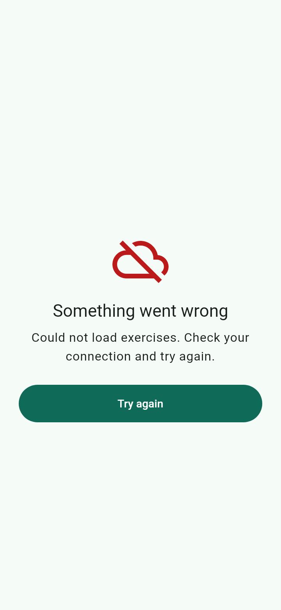 |

Dark theme (stretch goal):

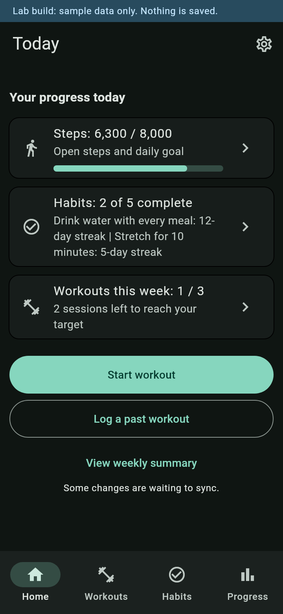

### How the screens connect

```
Welcome ── Get started / I already have an account ──> Account access ── Sign in ──> Home

Bottom bar: Home | Workouts | Habits | Progress          (gear icon on each tab -> Settings)

Home ──> Steps & goal, Habits tab, Workouts tab, Workout log (live or past), Weekly summary
Workouts ──> Workout log (start, log past, or tap a workout to edit), Exercise catalogue (search icon), Settings
Workout log ── Add exercise ──> Exercise catalogue ──> Exercise detail ── Add to workout ──> back to the log
Workout log ── Finish and save ──> Success ──> Workouts
Habits ──> Habit editor (Add habit, or Edit on any habit)
Progress ──> Steps & goal, Workouts tab, Habits tab, Weekly summary
Settings ──> Steps & goal, Success / Empty / Error previews, Sign out (-> Welcome)
```

Every screen opened on top of a tab has a back arrow; the result screens have a button that leads on.

## Sample data

Everything is in [`lib/data/sample_data.dart`](lib/data/sample_data.dart):

- **Profile:** name, email, 8,000-step goal, 3 workouts a week, a 19:00 reminder.
- **Exercises:** 20 exercises in 7 categories (Chest, Back, Legs, Shoulders, Arms, Abs, Cardio) with equipment, muscles and a short description, shaped like wger's data.
- **Workouts:** 10 past sessions over three weeks (strength sessions with sets, reps and kg, and timed activities), plus the unsaved live draft shown by "Start workout".
- **Habits:** 6 habits with weekday schedules, streaks and reminder times, a week of ticks, and the 6 fitness templates of the habit editor.
- **Steps:** 24 days of step counts, with a few days not tracked.
- **Summaries:** weekly and monthly totals are added up from the lists above, so Home, Progress and the Weekly summary agree with each other. Dates are relative to today, so the data never looks old.

## Feature map

Which later feature goes on which screen.

| Screen | Feature that plugs in | When |
|---|---|---|
| Welcome | Skip to Home when a user is already signed in (`FirebaseAuth.authStateChanges`) | Next week (Firebase) |
| Account access | Firebase Auth email and password, password reset email | Next week (Firebase) |
| Home | Live totals from Cloud Firestore; today's steps from the step sensor | Firebase, then hardware session |
| Workout history | Workouts collection in Cloud Firestore, offline cache, "Pending sync" flag | Firebase |
| Workout log | Save and edit in Firestore; the draft survives closing the app (`shared_preferences`) | Firebase, local storage |
| Exercise catalogue | wger REST API (`http`): search, equipment and category filters, paging, offline cache | Already learnt (REST), wire in |
| Exercise detail | wger exercise images (`Image.network`), "View source" with `url_launcher` | REST |
| Habits | Habit ticks and streaks stored in Firestore | Firebase |
| Habit editor | Reminder notifications (`flutter_local_notifications`, `timezone`) | Hardware session |
| Steps and daily goal | Step counter (`pedometer`), activity permission (`permission_handler`), accelerometer fallback (`sensors_plus`) | Hardware session |
| Progress | Real charts (`fl_chart`) from saved step days, workouts and habit ticks | After Firebase |
| Weekly summary | Totals calculated from saved records, covered by unit tests | Testing lab |
| Settings and profile | Profile in Firestore, notification permission, sign out, delete account and data | Firebase, hardware session |
| Success / Empty / Error | Shown after real Firestore writes and failed API calls | Firebase, REST |
| Whole app | Widget and integration tests, signed release build | Testing and release labs |

## Submit

```bash
git add lab_sketch_to_screens
git commit -m "lab-screens"
git push
```

Never commit keys or keystores.

To refresh the screenshots after changing a screen:

```bash
flutter test --update-goldens --dart-define=SCREENSHOTS=true test/screenshots_test.dart
```
